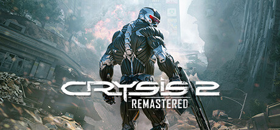

**Crysis 2 Remastered brings the city-based Nanosuit FPS to modern platforms with enhanced visuals, following USMC operator Alcatraz as he fights both an alien invasion and a corporate military force through a pandemic-struck New York City.**

---

## 📖 About

Crysis 2 Remastered brings the city-based Nanosuit FPS to modern platforms with enhanced visuals, following USMC operator Alcatraz as he fights both an alien invasion and a corporate military force through a pandemic-struck New York City.

## ⚠️ Problems Without Trainer

| Problem | Status |
|---------|--------|
| **Linear Structure** — Much more corridor-based than original's open-world sandbox | ✅ Solved |
| **Ceph Difficulty** — Alien units in later levels are significantly more lethal than human enemies | ✅ Solved |
| **Energy Depletion** — Rapid energy drain on maximum armor leaves players vulnerable frequently | ✅ Solved |
| **Short Campaign** — Completable in 7-8 hours before unlocking challenge modes | ✅ Solved |

## ✅ Solution

The **Crysis 2 Remastered Trainer** solves all these issues by giving you complete control over the game.

## 🎯 Full Feature List

- Unlimited Resources
- God Mode / Invincibility
- Instant Skill Cooldown
- One-Hit Kill
- Freeze Game Timer
- Unlock All Items & Achievements
- Custom Speed Multiplier
- Save State Anywhere

## 🚀 Quick Start

1. **Disable Windows Defender** temporarily (trainer may trigger false positive)
2. Download the trainer from the button above
3. Launch Crysis 2 Remastered
4. Run the trainer as Administrator
5. Activate desired cheats with hotkeys

## 💎 Free vs Paid

| Feature | Free | Pro |
|---------|------|-----|
| Basic God Mode | ✅ | ✅ |
| Unlimited Resources | ✅ | ✅ |
| All Advanced Cheats | ❌ | ✅ |
| Auto-Updates | ❌ | ✅ |
| Priority Support | ❌ | ✅ |

## 💻 Requirements

- Windows 10/11 (64-bit)
- Crysis 2 Remastered (any version)
- .NET Framework 4.8+
- DirectX 11+

## 🍎 macOS

macOS users can use our alternative tool:

## ⚖️ Legal

This trainer is for educational and single-player use only. Use responsibly.

---

